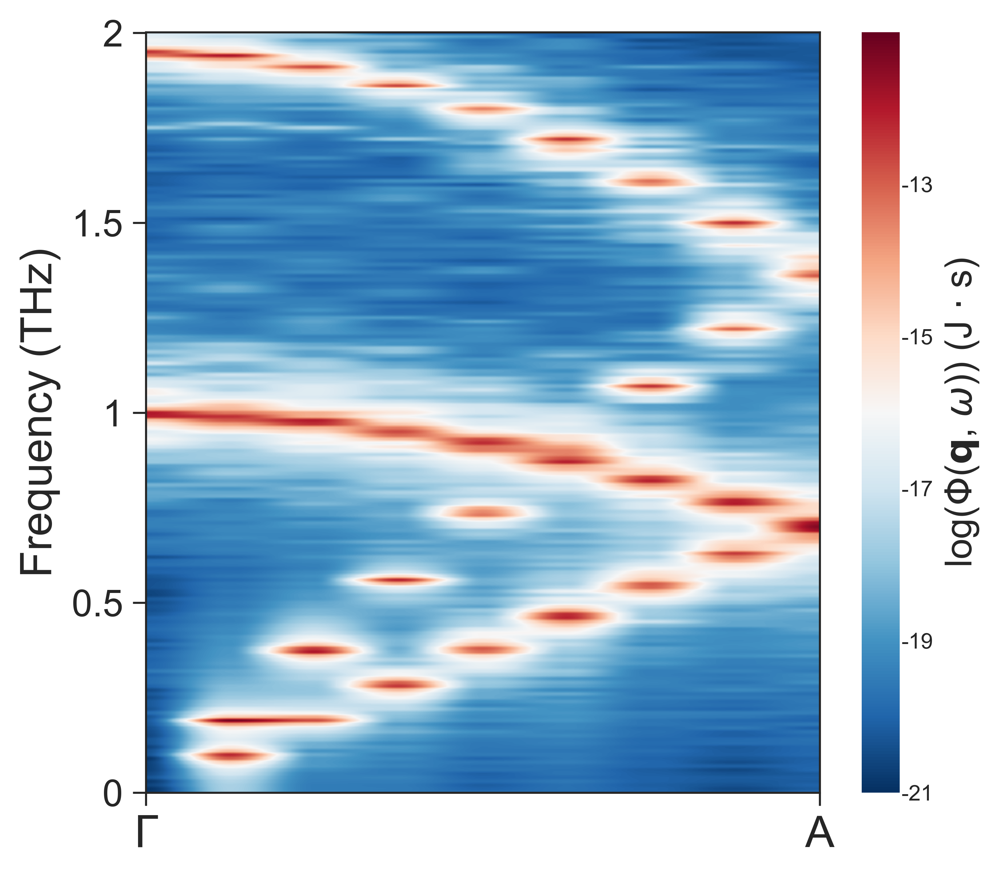

# 📢 pySED Tutorial: Bulk MoS2 SED with GPUMD

This example computes the low-frequency out-of-plane SED of layered MoS2 using
a GPUMD trajectory and pySED.

Reproduce this example before applying pySED to another layered or
two-dimensional material.

Use this example together with the
[online manual](https://pysed.readthedocs.io/en/latest/). For any unclear
`input.in` setting, go directly to the
[`input.in` parameter guide](https://pysed.readthedocs.io/en/latest/input_parameters.html).

> The illustration below is retained from pySED 2.4. The commands use
> pySED 3.0; recompute the SED and fits for current intensities and lifetimes.

---

## 🧭 Workflow Map

`[1. Structure] -> [2. GPUMD trajectory] -> [3. pySED SED] -> [4. Low-frequency plot] -> [5. Lorentz fitting]`

| Stage | Folder | Main files | Output |
|---|---|---|---|
| `[1. Structure]` | `structure/` | `POSCAR_MoS2`, `generate_lammps_data.py` | `model.xyz`, `basis.in` |
| `[2. GPUMD]` | `gpumd_run/` | `run.in`, `nep.txt` | `dump.xyz` |
| `[3. pySED]` | `SED/` | `input.in` | `bulk_MoS2.SED`, `bulk_MoS2.Qpts`, `bulk_MoS2.THz` |
| `[4. Plot]` | `SED/` | `input.in` | `bulk_MoS2-SED.png` |
| `[5. Fit]` | `SED/` | Lorentzian options | `Lifetime/Fitting-All-Qpoints.Fre_lifetime` |

---

## 🧱 [Step 1] -> Generate `model.xyz` and `basis.in`

Go to the structure folder:

```bash
cd example/MoS2_gpumd/structure
python generate_lammps_data.py
```

The script uses:

```python
from pySED.structure import generate_data

def generate_required_files(input_file, supercell):
    structure = generate_data.structure_maker(structure_file_name=input_file)
    structure.replicate_supercell(supercell=supercell)
    structure.write_xyz(filename='model.xyz', pbc="T T T")
    structure.write_lattice_basis_file()

if __name__ == "__main__":
    file_name = 'POSCAR_MoS2'
    supercell = (12, 12, 16)
    generate_required_files(file_name, supercell)
```

Input structure support:

- POSCAR-style files are supported, as used here with `POSCAR_MoS2`.
- `.xyz` files are also supported. For example, set
  `file_name = 'MoS2_primitive.xyz'` if your starting structure is an XYZ file.

Generated files:

- `model.xyz`: GPUMD structure file.
- `basis.in`: pySED basis mapping file.

---

## 🚀 [Step 2] -> Run GPUMD and write `dump.xyz`

Go to the GPUMD folder:

```bash
cd ../gpumd_run
gpumd
```

The production block is:

```text
ensemble       nve
dump_exyz      50     1
run            500000
```

The matching pySED settings are:

```text
total_num_steps = 500000
time_step = 1
output_data_stride = 50
trajectory_file = '../gpumd_run/dump.xyz'
```

---

## ⚙️ [Step 3] -> Compute SED with pySED

Go to the SED folder:

```bash
cd ../SED
pysed input.in
```

For the first run, use:

```text
action = compute
```

The out-of-plane path is `G-A`:

```text
num_qpaths = 1
q_path_name = 'GA'
q_path = 0.0 0.0 0.0  0.0 0.0 0.5
```

---

## 📈 [Step 4] -> Plot low-frequency SED

After the SED files exist, set the following values in `SED/input.in`:

```text
action = plot
plot_cutoff_freq = 2.0
plot_interval = 0.5
```

The small frequency cutoff keeps the low-frequency out-of-plane branches
visible.



---

## 🎯 [Step 5] -> Fit Lorentzian peaks

For single-q-point fitting, set these values in `SED/input.in`:

```text
plot_slice = 1
action = fit
fitting_function = lorentz
lorentz_fit_all_qpoint = 0
lorentz_fit_freq_max = 2
```

Tune these key parameters in `SED/input.in`:

- [`qpoint_slice_index`](https://pysed.readthedocs.io/en/latest/input_parameters.html#qpoint-slice-index)
- [`peak_min_significance`](https://pysed.readthedocs.io/en/latest/input_parameters.html#peak-min-significance)
- [`initial_guess_hwhm`](https://pysed.readthedocs.io/en/latest/input_parameters.html#initial-guess-hwhm)

Set `lorentz_fit_all_qpoint = 1` and rerun `pysed input.in` to fit all
q-points. After all-q-point fitting, pySED writes
`Lifetime/Fitting-All-Qpoints.Fre_lifetime`.

---

## ✅ Checklist

- [x] [`num_atoms = 13824`](https://pysed.readthedocs.io/en/latest/input_parameters.html#num-atoms) matches `basis.in` and `dump.xyz`.
- [x] [`supercell_dim = 12 12 16`](https://pysed.readthedocs.io/en/latest/input_parameters.html#supercell-dim) matches the generated MoS2 supercell.
- [x] [`output_data_stride = 50`](https://pysed.readthedocs.io/en/latest/input_parameters.html#output-data-stride) matches `dump_exyz 50 1`.
- [x] [`plot_cutoff_freq = 2.0`](https://pysed.readthedocs.io/en/latest/input_parameters.html#plot-cutoff-freq) is used for low-frequency branch inspection.
